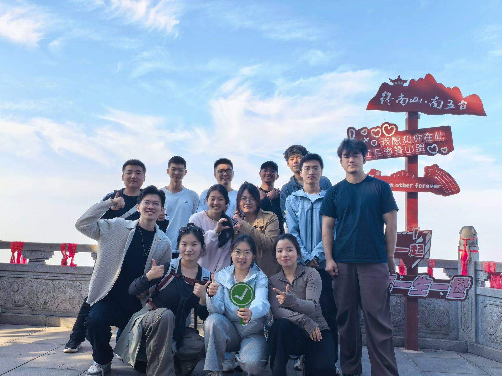
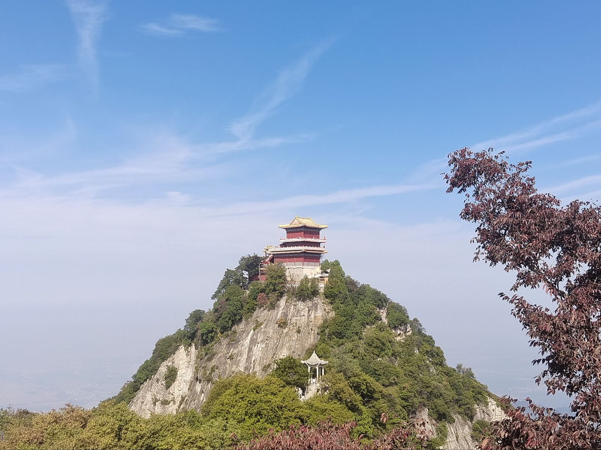
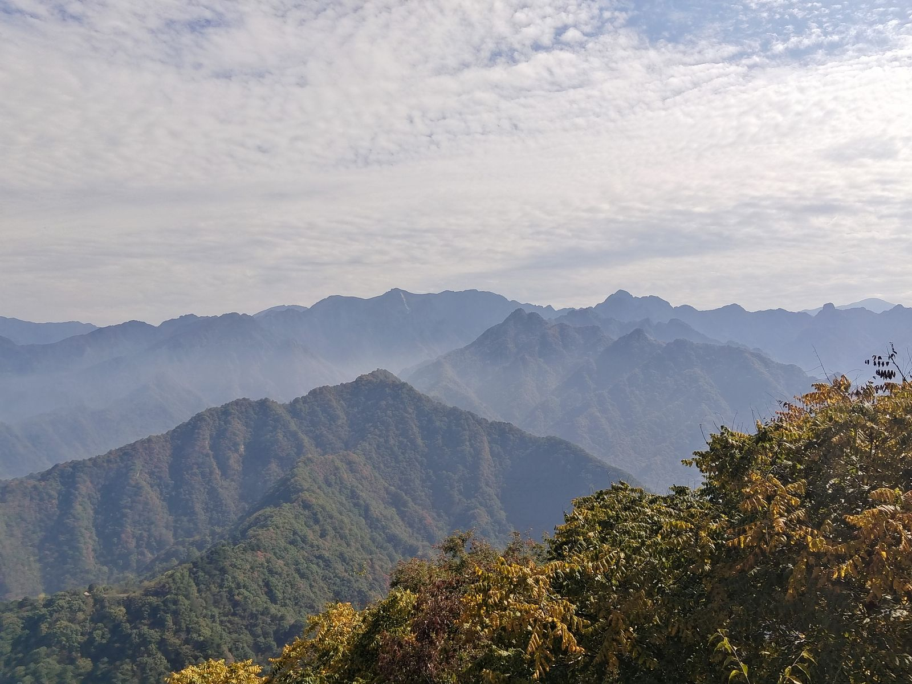

**Autumn Ascent, Taking in the Beauty of Zhongnan**

South Wutai, a famed scenic spot of the Zhongnan Mountains, is renowned for its "peculiar peaks, ancient temples, seas of clouds, and autumn colors." On the day of the event, the sky was high and the clouds light, with a gentle breeze — perfect weather for climbing. Ascending the mountain path step by step, though the trail wound and the steps were steep, members encouraged and supported one another, and with laughter all the way, they headed for the summit together.

From the heights, we gazed far into layered ridges and rolling mountains, brilliant autumn leaves, and swirling mist, revealing the grandeur and grace of the Zhongnan Mountains. The ancient buildings with red walls and golden roofs at the summit stood out strikingly amid the interweaving of evergreen and autumn yellow, and everyone paused to capture the beautiful natural scenery and the joy of the climb with their lenses.

**A Group Photo to Capture the Moments of Youth**

In front of the "Zhongnan Mountains · South Wutai" landmark sign, all members took a group photo. Giving thumbs-up with bright smiles, they displayed the lab team's vigorous, upward spirit and its united, striving outlook. Just as the romantic message on the sign — "I would like to make a vow of eternal love with you here" — suggests, this climb also witnessed the deep friendship of everyone walking hand in hand. The green checkmark held by members in the front row further symbolized our firm conviction on the research road of "overcoming difficulties and delivering on our mission."

**United in Strength, Embarking Together on a New Research Journey**

"When we reach the summit, all mountains appear small." This trip to South Wutai not only allowed everyone to relax after busy research and study and to appreciate the magnificence of nature, but also tempered our willpower through the climb and strengthened the lab's cohesion.

In the future, all members of the lab will keep this courage to climb and this spirit of collaboration, scaling new heights on the road of research and achieving further success!
