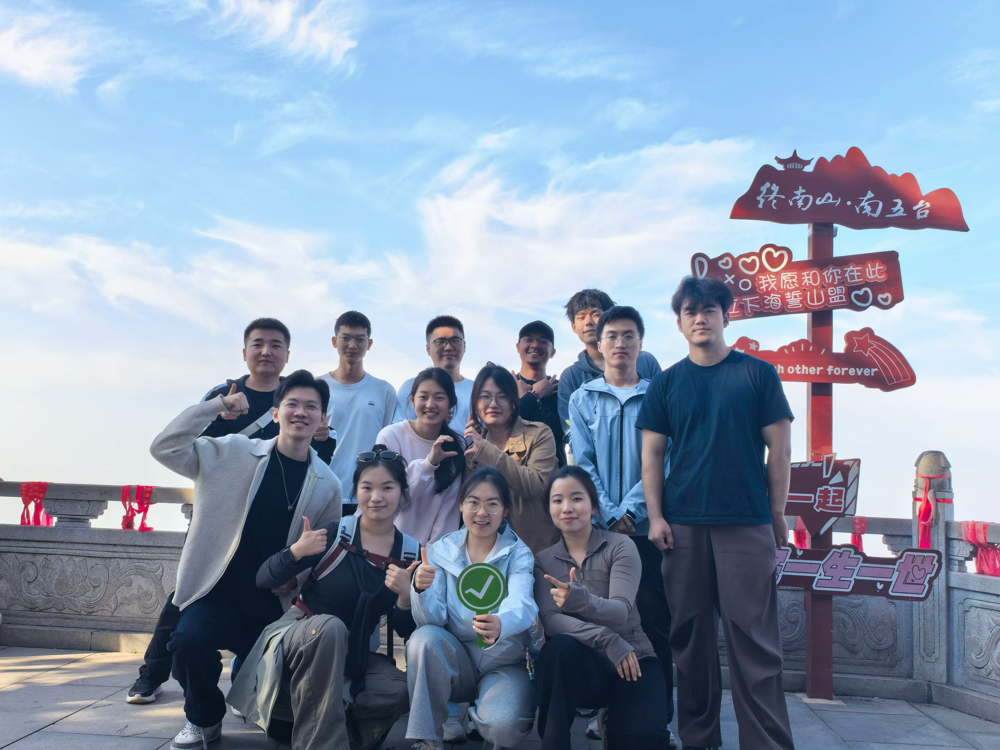
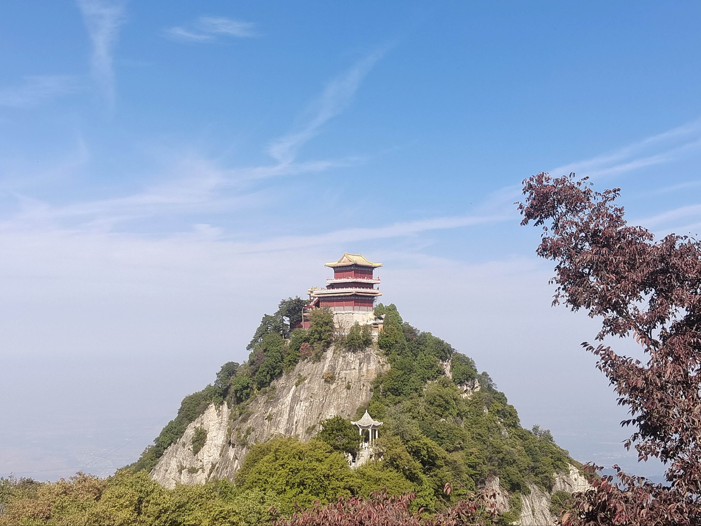
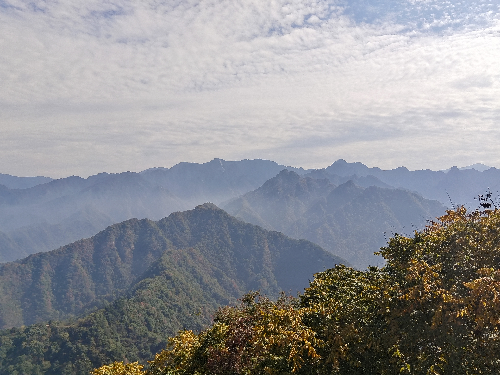

**秋日登高，尽览终南秀色**

南五台作为终南山的著名胜景，以“奇峰、古寺、云海、秋色”闻名。活动当日，天高云淡，微风拂面，正是登高的好时节。大家沿着山径拾级而上，虽山路蜿蜒、台阶陡峭，但成员们相互鼓励、彼此扶持，一路欢声笑语，共同向山顶进发。

行至高处，远眺层峦叠嶂，群山连绵，秋叶斑斓，云雾缭绕间尽显终南山的壮阔与灵秀。山顶红墙金顶的古建筑在苍翠与秋黄的交织中格外醒目，大家纷纷驻足，用镜头记录下这秀美的自然风光与攀登的喜悦。

**合影留念，定格青春时光**

在“终南山·南五台”标志牌前，全体成员合影留念。大家比出大拇指，笑容灿烂，展现了实验室团队蓬勃向上的朝气与团结奋进的精神面貌。正如标志牌上“我愿和你在此许下海誓山盟”的浪漫寓意，这次攀登也见证了大家携手同行的深厚情谊。前排成员手持的绿色对勾标识，更象征着我们科研路上“攻坚克难、使命必达”的坚定信念。

**凝心聚力，共赴科研新程**

“会当凌绝顶，一览众山小。”此次南五台之行，不仅让大家在繁忙的科研学习之余放松了身心，领略了大自然的壮美，更在攀登中磨砺了意志，增强了实验室的向心力。

未来，实验室全体成员将继续保持这份攀登的勇气与协作的默契，在科研道路上勇攀高峰，再创佳绩！