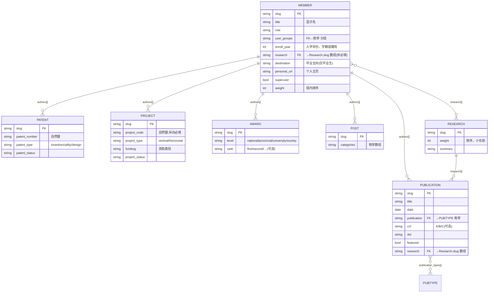

# 数据模型规范（DATA-MODEL）

站点无数据库，内容模型即数据库：**每个内容文件 = 一行记录，slug = 主键，front matter 字段 = 列，数组内引用其他实体 slug = 外键**。本文定义实体、主键、外键与关联关系；逐字段填写说明见 [`SCHEMA.md`](SCHEMA.md)（字段契约），两者配套使用：本文件管"结构与关系"，SCHEMA 管"怎么填"。

## 1. 实体总览

| 实体 | 存储位置 | 主键 (PK) | 说明 |
|------|----------|-----------|------|
| 成员 Member | `content/authors/<slug>/_index.md` | `slug`（拼音/id，如 `su-haonan`） | 导师与学生，`admin` 为负责人（`superuser: true`） |
| 论文 Publication | `content/publication/<slug>/index.md` | `slug`（建议 `年份-短名`，如 `2025-spdfusion`） | 期刊/会议论文 |
| 专利 Patent | `content/patent/<slug>/index.md` | `slug`（由 `patent_number` 规范化，如 `zl-2023109720647`） | 授权发明专利 |
| 项目 Project | `content/project/<slug>/index.md` | `slug`（有课题号时由 `project_code` 派生，如 `proj-62371389`） | 科研项目；`project_code` 纵向必填、横向可缺省，缺省时自然键退化为 slug |
| 奖项 Award | `content/award/<slug>/index.md` | `slug` | 奖项与荣誉 |
| 研究方向 Research | `content/research/<slug>/index.md` | `slug`（如 `low-light`） | 方向页，也是成员/论文的分组维度 |
| 动态 Post | `content/post/<slug>/index.md` | `slug` | 新闻动态 |
| 实验室配置 LabConfig | `config/_default/params.yaml` → `lab:` | 单例（singleton） | 全站唯一配置源，派生字段由脚本回写 |

命名约定：成员 slug 为小写拼音连字符；成果类 slug 保留导入脚本依据（`patent_number` / `project_code`），**slug 一经发布不可更改**（URL 即承诺）。

## 2. 实体关系图

## 3. 外键规则（作者引用的"双轨制"）

所有 `authors` 数组字段的取值有两种合法形态，渲染时由 `partials/components/resolve-author.html` 统一解析：

1. **成员引用（外键，推荐）**：直接写成员 slug（如 `admin`、`su-haonan`），渲染为带链接的成员页引用；
2. **外协人员（弱引用）**：写中文或英文全名（如 `金海燕`），纯文本展示、不生成链接。

别名解析：`data/lab_author_aliases.yaml` 维护「显示名/变体 → slug」映射（覆盖姓前/姓后/名前名后等书写差异）。**站点未启用 authors taxonomy**，禁止依赖 `/author/` 页面，避免孤儿页。

规则：

- 实验室成员一律写 slug；发现写的是显示名时，优先往 `lab_author_aliases.yaml` 补映射或改正文，而非新增游离文本
- 外协人员仅允许出现在 `authors` 中，不建 authors 页面

## 4. 枚举值（受控词表）

| 枚举 | 取值 | 存储位置 |
|------|------|----------|
| 成员分组 `user_groups` | 导师 / 博士生 / 研三 / 研二 / 研一 / 本科生 / 毕业生 | front matter；`/people/` 页按组渲染，**改名须全站同步**；与 `enroll_year` 由 lint 交叉校验 |
| 论文类型 `publication_types` | `article-journal` / `paper-conference` / `preprint` / `report` / `thesis` | Hugo taxonomy（`hugo.yaml` permalinks），中文标签经 i18n `pub_*` |
| 论文等级 `ccf` | `A` / `B` / `C`（可选） | front matter；卡片角标 |
| 专利类型 `patent_type` | `invention` / `utility` / `design` | front matter |
| 专利状态 `patent_status` | `granted` / `pending` | front matter |
| 项目类别 `project_type` | `vertical`（纵向）/ `horizontal`（横向） | front matter；纵向必须有 `project_code`，资助类别走 `funding` 字段 |
| 项目状态 `project_status` | `ongoing` / `completed` | front matter；与 `date_end` 由 lint 交叉校验 |
| 奖项级别 `level` | `national` / `provincial` / `university` / `society` | front matter |
| 奖项等级 `rank` | `special` / `first` / `second` / `third` / `excellent`（可选） | front matter |
| 动态分类 `categories` | 通知公告 / 学术活动 / …（开放但应克制） | front matter；列表页筛选依赖 |

v2 冗余治理原则（lint 强制执行）：**一个事实只存一处**——已删除 `research_focus`（由 `research[]` 派生）、`award_date`（由 `date` 承担）、`publishDate`（与 `date` 冗余）、成员 `organizations`（默认取 `params.lab.org_name`）；专利/项目/奖项的 tags 只放主题词，类型与状态一律走显式字段。

## 5. 派生数据与单一配置源

`params.lab` 是身份信息的唯一来源，以下为**派生字段，禁止手改**，由 `scripts/sync_lab_identity.py` 回写：

- `hugo.yaml` → `title`
- `languages.yaml` → `zh.title` / `zh.params.description`
- `params.yaml` → `marketing.seo.*`、`footer.copyright.notice`

成员卡的"研究方向"展示文字由 `research[]` 对应方向页标题实时派生（`partials/components/member-focus-text.html`），无 `research` 时回退解析 `bio`；首页统计条（规划中）在构建时由 Hugo 自动聚合，不落盘。

## 6. 现状差距与演进（对照升级计划）

| 差距 | 影响 | 状态 |
|------|------|------|
| ~~论文无 `research` 字段~~ | 检索页无法按方向筛选（升级项 B1） | **已解决**：字段已补，73 篇中 45 篇已按关键词预填（一次性迁移，脚本用毕即删），28 篇（历史/交叉工作）留空待人工归类；新内容走 archetype 与 CMS 表单兜底 |
| `featured` 字段全为 `false` | 首页只能展示"最新"而非"精选"（升级项 A3） | **待人工挑选** 3~5 篇置 `true`（CMS 论文表单已有开关） |
| `award_date` 与 `date` 需人工保持一致 | 年份筛选错位风险 | **已缓解**：archetype 模板同步生成 + lint 校验一致性 |
| 成员 `user_groups` 为自由文本 | 写错分组名即从成员页消失 | **已缓解**：archetype 限定注释 + CMS 受控下拉 + `scripts/lint_content.py` 校验（0 错误 0 警告通过） |

内容校验入口：`py -3 scripts/lint_content.py`（主键唯一性、外键有效性、枚举合法性、award_date 一致性等，退出码非 0 表示有错误，可接入 CI）。

## 7. 命名规范（六法则）

**字段**：snake_case；语义模式强制——链接一律 `url_*`（`url_pdf`/`url_code`/`url_external`…）、排序一律 `weight`、状态一律 `*_status`、类别一律 `*_type`。契约外字段由 lint 报错（`FIELD_CONTRACT`）；`date` 为 Hugo 排序惯例保留，各实体下的语义见各实体字段表。

**slug**：`<类型前缀>-<自然键>`——论文 `<年份>-<短名>`（含会议/期刊缩写置于年份后）、专利 `zl-<专利号数字>`、项目 `proj-<课题号|年份-英文短名>`、成员/方向/奖项/动态为小写短横线；长度上限由 `SLUG_RULES` 执行。**slug 一经发布不可更改**；确需更改必须同步在 front matter 补 `aliases` 重定向旧路径。

**脚本**：长期工具留 `scripts/` 根，命名 `<动词>_<对象>.py`（现状 4 个：`lint_content` / `sync_lab_identity` / `import_projects_patents` / `compress_post_images`）；一次性迁移脚本**用毕即删**（git 历史即归档），不养考古层。

**模板**：自研 partial 按领域分组于 `partials/{components,listing,article}/`，文件名不带前缀（目录即命名空间）；shortcodes 保留 `lab-` 前缀；**vendor 覆盖文件保留原名**（覆盖机制要求，如 `page_author.html`、`views/card.html`），不得"规范化"改名。

**文档**：大写蛇形命名（`DATA-MODEL.md` / `SCHEMA.md` / `CMS.md`）。

**媒体**：页面捆绑是内容图片唯一路径；`static/uploads` 已弃用删除，`images/` 仅存主题截图，`data/fonts` / `data/themes` 为字体与主题色配置（注释锚定，勿迁）。

## 8. 双语规范（zh / en）

站点启用 Hugo 多语言（`zh` 默认 + `en`），采用**文件名后缀式翻译**：

- **文件命名**：中文页 `X.md`（`_index.md` / `index.md`），英文页 `X.en.md`（`_index.en.md` / `index.en.md`），同目录成对；英文版**不写 `aliases`**（旧 URL 重定向只属中文页）。
- **翻译字段（按实体）**：
  - 论文：`title` / `summary` / `abstract`；`publication`（刊名专名）两语言一致；其余字段（作者/日期/卷页/DOI/链接/枚举）与中文版相同。
  - 成员：`title`（拼音 "名 姓"）/ `first_name` / `last_name` / `role` / `bio` / `interests` / `user_groups` / `destination`；`email` / `weight` / `research` / `enroll_year` 等共用。
  - 项目 / 专利 / 奖项 / 动态 / 研究方向：`title` / `summary` / `tags` / 正文（`body`）翻译，其余共用；专利标题保持"装置与方法"权利要求式直译。
- **受控词表按语言区分**：`user_groups` 中文侧（导师/博士生/研三/研二/研一/本科生/毕业生）与英文侧（Supervisor / Ph.D. Students / M.S. Year 1-3 / Undergraduates / Alumni）分别执法；成员页 `people/index.md` 与 `index.en.md` 的分组列表必须与对应语言成员档案逐一匹配。
- **研究方向正文四段式**：中文（方向简介/研究内容/关键问题/技术路线）、英文（Direction Overview / Research Topics / Key Challenges / Technical Approach），lint 双侧校验。
- **唯一性只看中文版**：`patent_number` / `project_code` / `superuser` 等自然键去重以中文页为准。
- **lint 执法**：`E-i18n` 缺英文版或英文版无对应中文页；`W-i18n` 英文 `title`/`summary` 残留中文（漏译提醒）。
- **CMS**：Sveltia `i18n.structure: multiple_files`，新建条目自动带出共用字段（`i18n: duplicate`），翻译字段各语言独立填写。
- **Windows 陷阱**：tag/slug 不得以句点结尾（如公司名 "Co., Ltd." 的句点会让构建在 Windows 上中断），专名 tag 省略尾缀句点。
