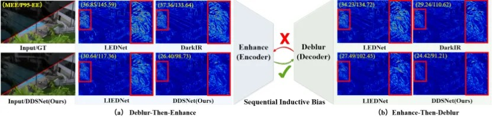
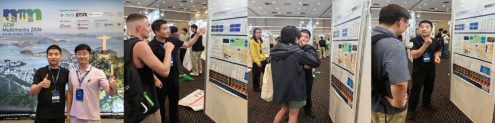

From November 10–14, 2026, ACM Multimedia 2026 was held in Rio de Janeiro. Our paper “Enhance-Then-Deblur: Revealing the Sequential Inductive Bias in Joint Low-Light Image Enhancement and Deblurring” was accepted and published.

## Authors

Guangbin Zhou (Ph.D. student / first author), Zhaolin Xiao (advisor / corresponding author), Wengai Li, Haonan Su, and Lifeng He (Aichi Prefectural University).

## Key finding

Joint low-light detail enhancement and deblurring exhibits a Sequential Inductive Bias: enhance-then-deblur is theoretically preferable to deblur-then-enhance.

The result drew interest from researchers during the conference.

## Venue and funding

ACM MM is a premier multimedia venue (CCF-A). This edition received 7,103 valid submissions and accepted 1,703 papers (23.9%). Supported by NSFC 62371389 and Shaanxi Education Department grant 25JK0382.

**Paper:** [https://doi.org/10.1145/3767308.3836239](https://doi.org/10.1145/3767308.3836239)

**Code:** [https://github.com/simpleOnly1/DDSNet](https://github.com/simpleOnly1/DDSNet)

**Citation:** Guangbin Zhou, Zhaolin Xiao, Wengai Li, Haonan Su, and Lifeng He. Enhance-Then-Deblur: Revealing the Sequential Inductive Bias in Joint Low-Light Image Enhancement and Deblurring [C]. In Proceedings of the 34th ACM International Conference on Multimedia (MM '26). Rio de Janeiro, Brazil, 2026, pp. 15852–15860.
