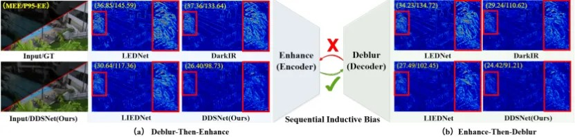
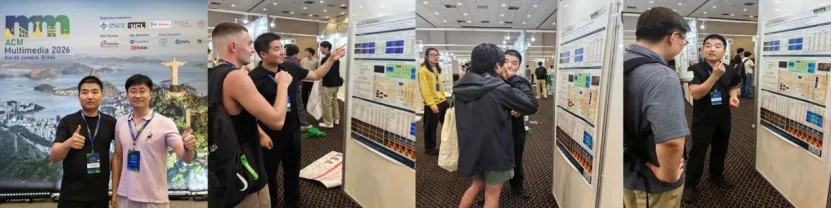

2026年11月10日至11月14日，第34届ACM国际多媒体会议（ACM Multimedia 2026）在巴西里约热内卢举行。实验室成果“Enhance-Then-Deblur: Revealing the Sequential Inductive Bias in Joint Low-Light Image Enhancement and Deblurring”被大会录用并发表。

## 作者与贡献

论文由周广彬（博士生/第一作者）、肖照林（导师/通讯作者）、李文改、苏浩楠、何立风（日本爱知县立大学教授）共同完成。

## 主要发现

弱光图像细节增强与去模糊联合任务存在次序偏置（Sequential Inductive Bias）：“先增强再去模糊”在理论上优于“先去模糊再增强”。

该发现为弱光增强网络设计提供了参考，大会期间亦受到多家机构学者关注。

## 会议与资助

ACM MM 为多媒体领域顶级会议（CCF-A）。本届有效投稿 7103 篇，录用 1703 篇，录取率 23.9%。工作获国家自然科学基金面上项目（62371389）与陕西省教育厅科学研究计划项目（25JK0382）资助。

**论文链接：** [https://doi.org/10.1145/3767308.3836239](https://doi.org/10.1145/3767308.3836239)

**论文代码：** [https://github.com/simpleOnly1/DDSNet](https://github.com/simpleOnly1/DDSNet)

**论文引用：** Guangbin Zhou, Zhaolin Xiao, Wengai Li, Haonan Su, and Lifeng He. Enhance-Then-Deblur: Revealing the Sequential Inductive Bias in Joint Low-Light Image Enhancement and Deblurring [C]. In Proceedings of the 34th ACM International Conference on Multimedia (MM '26). Rio de Janeiro, Brazil, 2026, pp. 15852–15860.
