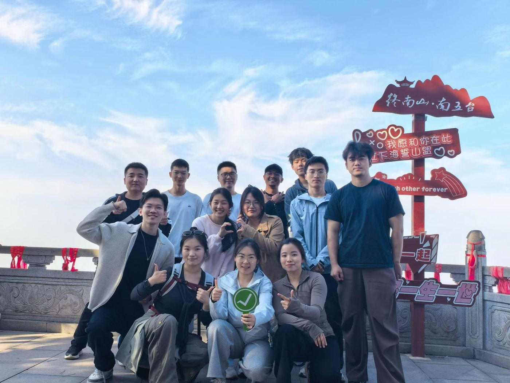
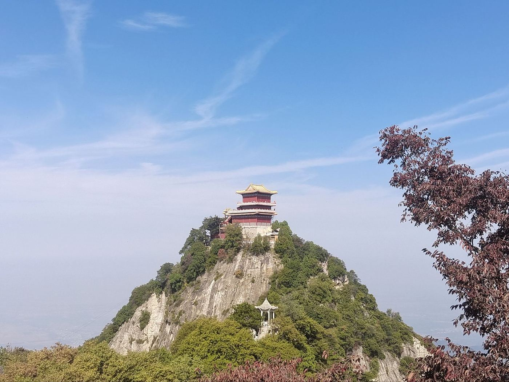
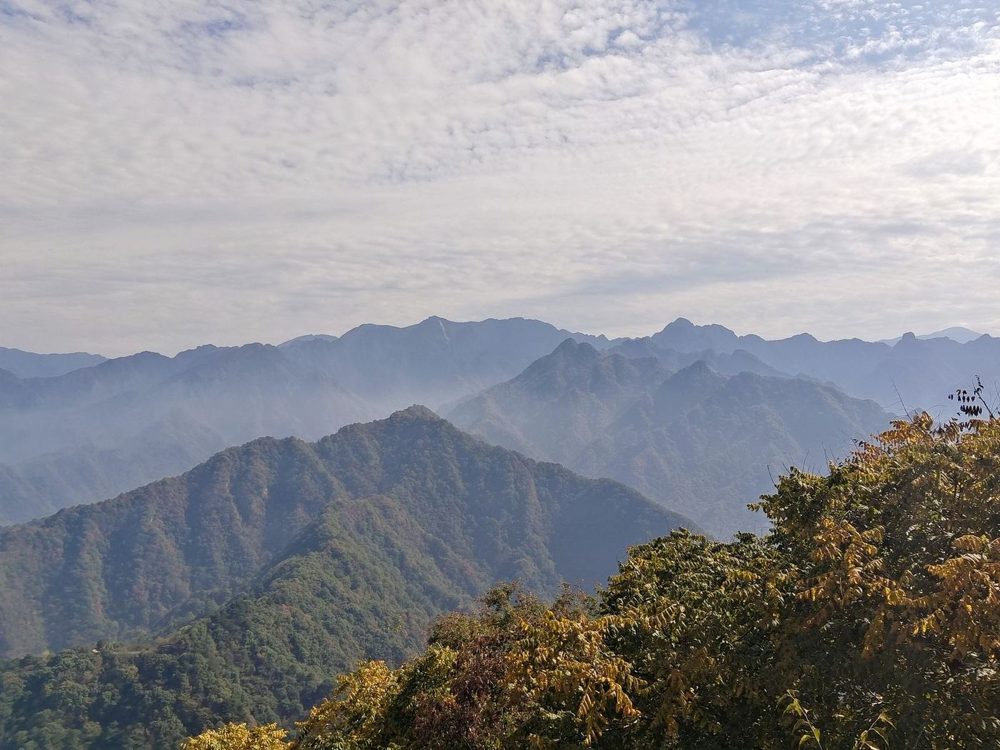

## Autumn ascent

South Wutai is known for its peaks, temples, cloud seas, and autumn color. Under a clear sky, members encouraged one another along the trail toward the summit.

From the heights: layered ridges, autumn leaves, and summit buildings set against evergreen and gold.

## Group photo

A full-team photo at the “Zhongnan Mountains · South Wutai” landmark.

## Moving forward

A day to rest, harden will, and climb together — on the mountain and in research.
